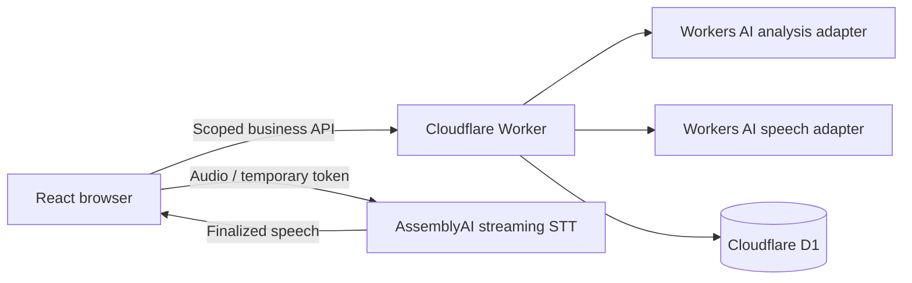

# GroomNote AI

## Judges: try the live product first

**Open the live demo linked on the hackathon submission page. Use an iPad or desktop browser and allow microphone access. No installation is needed to try the deployed product.** Deployment addresses are intentionally omitted from this source repository.

### Test appointments — copy one ID

| Scenario | Appointment ID |
| --- | --- |
| **Bella — review, repeat, correction and save** | **`44444444-4444-4444-8444-444444444444`** |
| **Charlie — automatic follow-up and answer** | **`55555555-5555-4555-8555-555555555555`** |

These are fictional appointment IDs, not login credentials. Refresh before each new session and use fictional information only; saved demo notes are persisted.

### Recommended walkthrough: Bella

1. Enter **Bella's Appointment ID**, wait for browser verification, and click **Start GroomNote**.
2. Allow microphone access if prompted. Wait until the opening finishes and the page is listening, then say:

   > Today I groomed Bella. She had a bath and brush. I cleaned her ears. She was calm throughout the groom. Next time, check her ears again. That's everything.

3. Wait for the spoken review. If a follow-up is asked, answer and finish with **“That's everything.”**
4. Once listening resumes, say **“Repeat that.”** Wait for playback to finish.
5. Say **“Actually remove brushing and add nail trim.”** Wait for the updated review.
6. Say **“Save the note.”** Look for the saved summary and verified persistence confirmation, then listen for the success announcement.

Speak only after playback finishes. Say **“Discard this note.”** instead of saving to cancel. Bare **“Yes”** does not save. Visible manual controls remain available if browser audio or a provider interrupts the workflow.

### Optional walkthrough: Charlie

Refresh, enter **Charlie's Appointment ID**, and start. After the opening finishes, say:

> Today I groomed Charlie. He was nervous when I used the dryer. That's everything.

Wait for the spoken follow-up and automatic listening, then say:

> I lowered the dryer speed and gave Charlie a short break. He calmed down. I completed his bath and brush. Next time, start with lower airflow. That's everything.

The product should proceed to review without another business question. Then say **“Save the note”** or **“Discard this note.”** Recognition, model wording and timing can vary.

## About GroomNote

**Your grooming handover, made simple.** A voice-first assistant that turns a groomer's spoken recap into a structured, reviewed handover note. Built for the [AssemblyAI Voice Agent Hackathon](https://lablab.ai/ai-hackathons/assemblyai-voice-agent-hackathon).

This repository is a **public technical showcase derived from the real development history**. It explains the implementation; private model instructions and deployment configuration are not included. Live analysis is deliberately disabled in this copy. It is not a turnkey installation of the deployed product.

## The problem

Groomers need their hands and attention for the animal. Useful handover details—services, behavior, what helped, and what to do next time—can be lost when documenting them requires repeatedly operating a screen.

GroomNote lets the groomer speak a natural recap, hear a review, correct it, and explicitly approve saving.

## The demo experience

```text
Start → spoken opening → automatic listening
      → “That's everything” → analysis
      → optional single follow-up → spoken review
      → repeat / correction / explicit save / discard
      → retrieved saved note → spoken success
```

| Capability | What the product demonstrates |
| --- | --- |
| Capture | Streaming speech recognition and finalized-transcript command detection |
| Follow-up | At most one business question across the session, including correction |
| Review | A structured draft and spoken summary |
| Correction | Existing correction semantics, a new revision, and a new review |
| Repeat | Current review playback without changing the draft |
| Save | Explicit approval of the reviewed revision and retrieval verification |
| Recovery | Silence confirmation, visible manual controls, and recoverable errors |

Bare “Yes” does not silently save. Missing or uncertain details remain explicit. Playback and microphone capture do not overlap.

## Where AssemblyAI fits

AssemblyAI is the live speech-input layer. The Worker obtains temporary streaming credentials; the browser streams microphone audio directly to AssemblyAI. Finalized transcript turns go to the Worker for the business workflow. Partial transcripts and ordinary provider end-of-turn events do not complete the report.



The frontend orchestrator coordinates existing services; it does not replace the backend state machine. The Worker remains authoritative for drafts, revisions, approval and persistence. The browser retrieves the saved note before announcing success.

**Stack:** React, TypeScript, Vite, Hono, Zod, Cloudflare Workers/D1/Turnstile, AssemblyAI, Workers AI Llama 3.2 3B and MeloTTS. A Python client supports engineering workflows.

## Read the implementation

| Question | Source |
| --- | --- |
| How are voice steps coordinated? | [Frontend orchestrator](web/src/services/orchestration/controller.ts) |
| How are spoken commands classified? | [Command grammar](web/src/services/orchestration/commands.ts) |
| How is microphone/playback overlap prevented? | [Half-duplex gate](web/src/services/audio/halfDuplex.ts) |
| How are STT turns finalized and delivered? | [Browser STT controller](web/src/services/stt/controller.ts) |
| How does business state remain authoritative? | [State model](src/state-machine/model.ts) and [service](src/state-machine/service.ts) |
| How are correction retries and revisions handled? | [Correction lifecycle](src/state-machine/correction.ts) |
| How is approval persisted? | [Worker routes](src/api/routes.ts) and [D1 repository](src/persistence/repository.ts) |
| How is endless follow-up prevented? | [Follow-up policy](src/analysis/follow-up-policy.ts) |

## History and disclosure

All **35 original reachable commits** are retained as sanitized counterparts with their original author/committer timestamps, order and parent relationships. The branch layout and two release milestone tags are retained. Author attribution is anonymized; commit and tag hashes differ. Documentation-only commits may be empty because their private contents were excluded.

The sanitized W06/backend tags identify historical source milestones, **not runnable substitutes for the private frozen releases**. Two new documentation commits prepare the public presentation and judge instructions. The default branch is `main`; the historical branches remain available. No development commits were fabricated or backdated.

See [history and omissions](docs/PUBLIC_HISTORY.md) for the disclosure policy.

## Limits and license

- Private extraction/correction prompts, speech copy, internal reports, live recordings, personal documents and real deployment identifiers are omitted throughout the history.
- Fake analysis is stubbed, live analysis fails explicitly, and configuration values use placeholders. This copy cannot reproduce production provider behavior or test results.
- The deployed product remains subject to transcription/model errors, browser permissions, provider latency and cost. Review before approving. Public-showcase sanitization is not a production security repair.
- The latest one-follow-up policy has automated/provider evidence in the private project; its separate physical iPad acceptance was still pending when this snapshot was prepared.

Original project code in this showcase is provided under the [MIT License](LICENSE). Third-party dependencies and model services retain their own terms; see [third-party notices](THIRD_PARTY_NOTICES.md).
